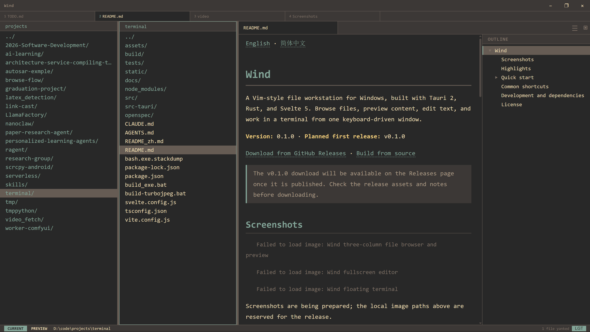

[English](README.md) · [简体中文](README_zh.md)

# Wind

A Vim-style file workstation for Windows, built with Tauri 2, Rust, and Svelte 5. Browse files, preview content, edit text, and work in a terminal from one keyboard-driven window.

**Latest release:** v0.2.0

[Download from GitHub Releases](https://github.com/LHkeeper666/wind/releases) · [Build from source](#build-from-source)

The Releases page contains the current Windows installer and notes for each version.

## Screenshots



## Highlights

- **File navigation:** parent directory, current directory, and preview/editor panels; adjustable column ratios and a project tree view.
- **Keyboard workflow:** Vim-style directory navigation, file operations, search, tabs, preview slots, and an in-app shortcut reference (`F1`).
- **Previews:** text, Markdown, JSON, images, PDF, video, archives, and directories. Images and PDFs have fullscreen viewers.
- **Editing and terminal:** CodeMirror 6 with Vim mode; a floating ConPTY terminal for PowerShell, CMD, and Git Bash.
- **File management:** copy, move, rename, trash and restore, archive browsing/extraction, and local/FTP transfers.

Video thumbnails require an available FFmpeg executable. Video playback uses a local HTTP stream and the embedded webview's supported codecs; FFmpeg availability alone does not guarantee playback of every format.

## Quick start

### Download and use

Open [GitHub Releases](https://github.com/LHkeeper666/wind/releases), download the Windows x64 installer for the latest release, and run it. No Node.js or Rust setup is needed to run a release build.

After opening Wind, navigate with `j`/`k`, press `Enter` to open a directory or preview a file, and press `F1` for the full shortcut reference. Press `:` to open the command palette.

### Build from source

On Windows, install Node.js with npm, the stable Rust toolchain, and the Windows C++ build tools required by Tauri. The repository does not specify minimum toolchain versions. From the repository root:

```powershell
npm install
./scripts/fetch-pdfium.ps1
npm run tauri dev
```

To produce a release bundle:

```powershell
npm run tauri build
```

The PDFium script downloads the pinned 151.0.7891.0 Windows x64 archive, verifies its SHA-256 hashes, and installs the DLL and accompanying license files. The Tauri bundle includes both. FFmpeg is a separate executable used for video thumbnails; make it available on `PATH` or through `WIND_FFMPEG_PATH`.

## Common shortcuts

| Context | Keys | Action |
| --- | --- | --- |
| Global | `F1` | Show all shortcuts and commands |
| Global | `:` / `Ctrl+P` | Command palette / file search |
| Global | Ctrl+Backtick | Toggle floating terminal |
| Global | `Ctrl+W h/l` | Focus the left/right panel |
| Global | `Ctrl+W m` | Cycle three-, two-, and one-column layouts |
| Directory | `j/k`, `gg/G` | Move and jump to top/bottom |
| Directory | `Enter` / `l` | Open directory or preview file |
| Directory | `h` | Go to parent directory |
| Directory | `Space`, `y`, `x`, `p` | Select, copy, cut, paste |
| Global / terminal | `Alt+N`, `Alt+U` | Create / close tab |
| Global | `g r` | Toggle Recycle Bin view |

In the command palette, `:cd <path>` changes directory, `:e <path>` opens a file or directory, and `:ratio X:Y:Z` changes column widths. `Tab` completes paths for `:cd` and `:e`.

## Development and dependencies

| Part | Main dependencies |
| --- | --- |
| Desktop | Tauri 2, Rust, Windows ConPTY |
| Frontend | SvelteKit, Svelte 5, TypeScript |
| Editor and terminal | CodeMirror 6, Vim extension, xterm.js |
| Previews | PDFium, Shiki, markdown-it, KaTeX, Mermaid, turbojpeg |
| Optional video tooling | FFmpeg executable for thumbnails |

```powershell
npm run check
npm test
cargo check --manifest-path src-tauri/Cargo.toml
```

## License

Wind's own code is licensed under the [MIT License](LICENSE), copyright (c) 2026 LHkeeper666. Bundled PDFium and its dependencies retain their own licenses in [`src-tauri/third-party/pdfium/`](src-tauri/third-party/pdfium/).
