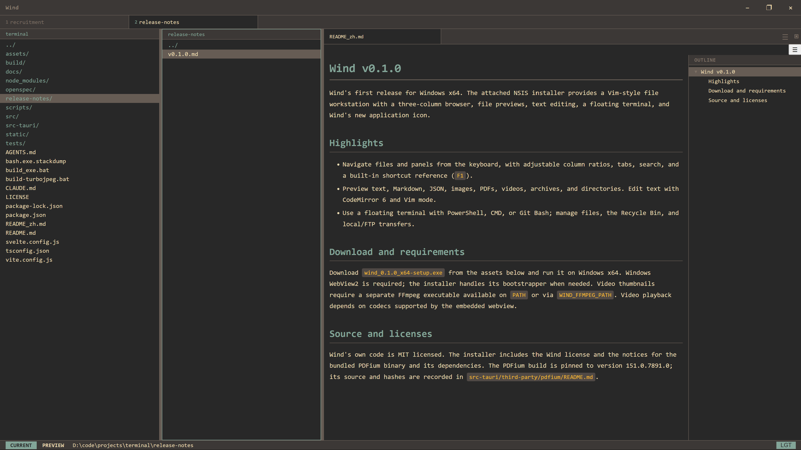

[English](README.md) · [简体中文](README_zh.md)

# Wind

Wind 是面向 Windows 的 Vim 风格文件工作站，基于 Tauri 2、Rust 和 Svelte 5。在一个以键盘操作为主的窗口中浏览文件、预览内容、编辑文本并使用终端。

**当前版本：**0.1.0 · **计划首发版本：**v0.1.0

[前往 GitHub Releases 下载](https://github.com/LHkeeper666/wind/releases) · [从源码构建](#从源码构建)

> v0.1.0 发布后，下载文件将在 Releases 页面提供。下载前请查看发布资源和说明。

## 产品截图



## 核心功能

- **文件导航：**父目录、当前目录、预览/编辑器三栏布局，可调整列宽比例，并可切换项目树视图。
- **键盘操作：**Vim 风格目录导航、文件操作、搜索、标签页和预览槽；按 `F1` 查看应用内完整快捷键表。
- **多格式预览：**文本、Markdown、JSON、图片、PDF、视频、压缩包和目录；图片与 PDF 支持全屏查看。
- **编辑与终端：**CodeMirror 6 编辑器及 Vim 模式；基于 ConPTY 的浮动终端支持 PowerShell、CMD 和 Git Bash。
- **文件管理：**复制、移动、重命名、移入回收站与还原、浏览和解压压缩包、本地及 FTP 传输。

视频缩略图需要可用的 FFmpeg 可执行文件。视频播放使用本地 HTTP 流及内嵌 WebView 支持的编解码器；安装 FFmpeg 不代表所有视频格式都能播放。

## 快速上手

### 下载后使用

打开 [GitHub Releases](https://github.com/LHkeeper666/wind/releases)，在 v0.1.0 发布后选择合适的 Windows 发布资源，并按照该版本的发布说明使用。运行发布版本不需要安装 Node.js 或 Rust。具体文件名和安装步骤须待发布时确认。

打开 Wind 后，使用 `j`/`k` 移动，按 `Enter` 进入目录或预览文件，按 `F1` 查看完整快捷键；按 `:` 打开命令面板。

### 从源码构建

在 Windows 上准备带 npm 的 Node.js、稳定版 Rust 工具链，以及 Tauri 构建所需的 Windows C++ 构建工具。仓库没有规定最低工具链版本。在仓库根目录运行：

```powershell
npm install
./scripts/fetch-pdfium.ps1
npm run tauri dev
```

生成发布构建：

```powershell
npm run tauri build
```

PDFium 脚本下载固定版本的 151.0.7891.0 Windows x64 归档、校验 SHA-256，并安装 DLL 和配套许可文件；Tauri 会将两者一起打包。FFmpeg 是用于视频缩略图的独立可执行文件，可放入 `PATH`，或通过 `WIND_FFMPEG_PATH` 指定。

## 常用快捷键

| 场景 | 按键 | 操作 |
| --- | --- | --- |
| 全局 | `F1` | 查看所有快捷键和命令 |
| 全局 | `:` / `Ctrl+P` | 命令面板 / 文件搜索 |
| 全局 | Ctrl+Backtick | 切换浮动终端 |
| 全局 | `Ctrl+W h/l` | 聚焦左/右面板 |
| 全局 | `Ctrl+W m` | 循环切换三栏、两栏和单栏布局 |
| 目录 | `j/k`、`gg/G` | 移动及跳到顶部/底部 |
| 目录 | `Enter` / `l` | 进入目录或预览文件 |
| 目录 | `h` | 返回父目录 |
| 目录 | `Space`、`y`、`x`、`p` | 选择、复制、剪切、粘贴 |
| 全局 / 终端 | `Alt+N`、`Alt+U` | 新建 / 关闭标签页 |
| 全局 | `g r` | 切换回收站视图 |

命令面板支持 `:cd <path>` 切换目录、`:e <path>` 打开文件或目录、`:ratio X:Y:Z` 调整列宽；`:cd` 和 `:e` 支持 `Tab` 路径补全。

## 开发构建与依赖

| 部分 | 主要依赖 |
| --- | --- |
| 桌面端 | Tauri 2、Rust、Windows ConPTY |
| 前端 | SvelteKit、Svelte 5、TypeScript |
| 编辑器与终端 | CodeMirror 6、Vim 扩展、xterm.js |
| 预览 | PDFium、Shiki、markdown-it、KaTeX、Mermaid、turbojpeg |
| 可选视频工具 | 用于生成缩略图的 FFmpeg 可执行文件 |

```powershell
npm run check
npm test
cargo check --manifest-path src-tauri/Cargo.toml
```

## 许可证

Wind 自有代码采用 [MIT 许可证](LICENSE)，版权所有 (c) 2026 LHkeeper666。随安装包分发的 PDFium 及其依赖保留各自的许可证，见 [`src-tauri/third-party/pdfium/`](src-tauri/third-party/pdfium/)。
